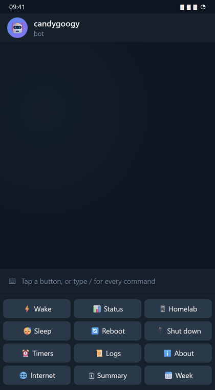

<h1 align="center">candygoogy-bot</h1>

<p align="center">
A Telegram bot that wakes, sleeps, shuts down and checks the machines on your LAN,
and keeps an eye on your homelab.
</p>

<p align="center">
  <a href="https://github.com/candygoogy/candygoogy-bot/actions/workflows/ci.yml"></a>
  <a href="https://github.com/candygoogy/candygoogy-bot/actions/workflows/docker.yml"></a>
  <a href="https://github.com/candygoogy/candygoogy-bot/actions/workflows/audit.yml"></a>
  <a href="LICENSE"></a>
  
</p>

<p align="center">
  
  <br>
  <sub><i>Illustration: a mock chat with fake data.</i></sub>
</p>

## Why

You have a small server that is always on (a Raspberry Pi, a NAS, a mini PC),
and PCs that aren't. This bot runs on the server and lets you wake, sleep,
reboot and shut down those PCs from Telegram, safely: every power action asks
first, and the bot reports what actually happened ("Booted in 45s", "Shut down
in 8s"), not just that it sent a command. It also watches the server itself.

## Contents

- [Features](#features)
- [Quickstart with Docker](#quickstart-with-docker)
- [Install without Docker](#install-without-docker)
- [Preparing the machines](#preparing-the-machines)
- [Configuration](#configuration)
- [Commands](#commands)
- [How each feature works](#how-each-feature-works)
- [Security model](#security-model)
- [Development](#development) and [Changelog](CHANGELOG.md)
- [License](#license) and [Contact](#contact)

## Features

- **Wake-on-LAN** with a real follow-up: "Booted in 45s" or "Woke from sleep in 4s".
- **Sleep, reboot and shut down** over SSH, each after a confirmation, then
  checked: "Shut down in 8s".
- **Timers**: shut down at 22:30, wake in 8 hours, or every weekday at 23:00;
  with a warning before a shutdown.
- **Several machines**: Windows, and Linux and macOS (**experimental**), picked
  by name or with a button.
- **Homelab health**: disks, temperature, failed services, Docker containers,
  updates, pending reboots and backups, with alerts when something goes wrong and
  when it clears.
- **Internet outages**: noticed, timed and reported when the connection is back.
- **A daily summary and a weekly report**, sent at times you choose.
- **Logs in the chat**: recent lines, or everything as a file.

## Quickstart with Docker

You need a Linux host with **rootful Docker Engine** on the same network as your
PCs. Docker Desktop and rootless Docker can't send Wake-on-LAN packets to the LAN.

1. Create a bot with [@BotFather](https://t.me/BotFather) and copy its token.
   Find your numeric Telegram user ID (bots like @userinfobot show it).
2. Get the code and fill in the configuration:

   ```sh
   git clone https://github.com/candygoogy/candygoogy-bot.git
   cd candygoogy-bot
   cp .env.example .env
   nano .env    # BOT_TOKEN, AUTHORIZED_USER_IDS, and one machine (or MACHINES_FILE)
   ```

3. Make the bot's SSH key. The container runs as UID/GID 10001, so the folder
   and the key must be readable by group 10001, and owned by root so the bot
   can't change them:

   ```sh
   sudo install -d -o root -g 10001 -m 750 ssh
   sudo ssh-keygen -t ed25519 -N "" -C candygoogy-bot -f ssh/id_ed25519
   sudo chown root:10001 ssh/id_ed25519 && sudo chmod 640 ssh/id_ed25519
   ```

   Then set up each PC to accept that key: see [Preparing the machines](#preparing-the-machines).

4. Pull the image, check the configuration, and start:

   ```sh
   docker compose pull
   docker compose run --rm --no-deps bot python bot.py --check-config
   docker compose up -d
   docker compose logs -f bot
   ```

5. In Telegram, open a private chat with your bot and send `/start`.

The image is `ghcr.io/candygoogy/candygoogy-bot`, for amd64 and arm64 (e.g. a
Raspberry Pi with a 64-bit OS), published for every release from v1.1.0 on.
`docker-compose.yml` follows the latest 1.x release; to pin one, set
`CANDYGOOGY_TAG` in `.env` (see `.env.example`). Every image has a signed build
provenance attestation, so you can check it was built by this repository's
release workflow, from the tagged commit:

```sh
gh attestation verify oci://ghcr.io/candygoogy/candygoogy-bot:1 --owner candygoogy
```

<details>
<summary><b>Build the image yourself instead</b></summary>

`docker-compose.build.yml` builds the image from your checkout (as
`candygoogy-bot:local`, never the published name). Use it for step 4:

```sh
export CANDYGOOGY_COMMIT="$(git rev-parse HEAD)"   # shown by /about
docker compose -f docker-compose.yml -f docker-compose.build.yml build
docker compose -f docker-compose.yml -f docker-compose.build.yml \
  run --rm --no-deps bot python bot.py --check-config
docker compose -f docker-compose.yml -f docker-compose.build.yml up -d
```

Add `-f docker-compose.build.yml` to every later `docker compose` command too.

</details>

`--check-config` prints `OK: the configuration is valid.`, or lists the
problems by variable name (never their values). The bot uses `ping` without any
privileges, which needs the host's `sysctl net.ipv4.ping_group_range` to include
group 10001. The default on most systemd hosts (`0 2147483647`) does; if yours
prints `1 0`, fix it once:

```sh
echo 'net.ipv4.ping_group_range = 0 2147483647' | sudo tee /etc/sysctl.d/60-ping.conf
sudo sysctl --system
```

<details>
<summary><b>Optional: Docker containers in <code>/homelab</code></b></summary>

Docker's own socket is root on the host, so the bot never gets it. Instead, a
small proxy ([wollomatic/socket-proxy](https://github.com/wollomatic/socket-proxy))
allows exactly one request, the container list:

```sh
echo "DOCKER_GID=$(getent group docker | cut -d: -f3)" >> .env
docker compose -f docker-compose.yml -f docker-compose.docker-proxy.yml up -d
```

</details>

<details>
<summary><b>Optional: accurate disks and "reboot required" from the host</b></summary>

Inside a container, `/` is Docker's disk and the host's `/run/reboot-required`
isn't visible. Uncomment the `/host` mount and `HOMELAB_HOST_ROOT: /host` in
`docker-compose.yml` to read them from the host (read-only). The bot can then read
whatever on the host is world-readable, so never combine it with access to
Docker's socket.

</details>

## Install without Docker

On a Debian-like host with systemd, the bot runs as a hardened service. The
layout is code in `/opt/candygoogy-bot`, configuration in
`/etc/candygoogy/bot.env`, SSH keys in `/etc/candygoogy/ssh/` and state in
`/var/lib/candygoogy-bot`. The one-time setup commands are at the top of
[`deploy/candygoogy-bot.service`](deploy/candygoogy-bot.service); in short:

```sh
sudo useradd --system --user-group --home-dir /var/lib/candygoogy-bot \
    --no-create-home --shell /usr/sbin/nologin candygoogy
sudo install -d -o candygoogy -g candygoogy -m 755 /opt/candygoogy-bot
sudo -u candygoogy git clone https://github.com/candygoogy/candygoogy-bot.git /opt/candygoogy-bot
sudo -u candygoogy python3 -m venv /opt/candygoogy-bot/venv
sudo -u candygoogy /opt/candygoogy-bot/venv/bin/pip install --no-cache-dir --require-hashes \
    -r /opt/candygoogy-bot/requirements.txt
sudo install -d -o root -g candygoogy -m 750 /etc/candygoogy /etc/candygoogy/ssh
sudo install -o root -g candygoogy -m 640 /opt/candygoogy-bot/.env.example /etc/candygoogy/bot.env
sudoedit /etc/candygoogy/bot.env
sudo cp /opt/candygoogy-bot/deploy/candygoogy-bot.service /etc/systemd/system/
sudo systemctl daemon-reload && sudo systemctl enable --now candygoogy-bot
```

The host needs `ping` (iputils-ping), `ip` (iproute2) and `ssh` on the PATH. The
unit has no capabilities, so ping needs the same `ping_group_range` setting as
in the Docker quickstart. A configuration error stops the service with exit
code 2 instead of restarting it over and over; `journalctl -u candygoogy-bot`
says which variables are wrong.

**Updates:** `/opt/candygoogy-bot/deploy/deploy.sh` (as an admin). It stops at the
first failure, without restarting:

1. `git pull --ff-only`, as the checkout's owner;
2. `pip install --no-cache-dir --require-hashes -r requirements.txt`;
3. [`deploy/check-env.sh`](deploy/check-env.sh): the required variables
   (`BOT_TOKEN`, `AUTHORIZED_USER_IDS`) exist and aren't empty;
4. `bot.py --check-config` with `bot.env` and the unit's defaults, as the
   service will see them;
5. compares the installed unit with the repo's and prints the commands to
   update it (it never installs it itself);
6. restarts the service and checks that it runs.

The "Reboot homelab" button needs one polkit rule, which allows only that:
`sudo install -m 644 /opt/candygoogy-bot/deploy/50-candygoogy-reboot.rules /etc/polkit-1/rules.d/`.

## Preparing the machines

Each machine needs an SSH server that accepts the bot's key (restricted to the
bot's host), a rule that lets that user power the machine off, and Wake-on-LAN:

- [Windows](docs/windows-target.md)
- [Linux](docs/linux-target.md) (experimental)
- [macOS](docs/macos-target.md) (experimental; wakes from sleep only)

The power rules to copy are in [`deploy/targets/`](deploy/targets/). For
Wake-on-LAN, turn it on in the BIOS/UEFI and on the network card, use a wired
connection, and give each machine a fixed IP (a DHCP reservation).

## Configuration

Everything is set with environment variables: in `.env` for Docker,
`/etc/candygoogy/bot.env` for systemd. [`.env.example`](.env.example) lists them
all with examples. Only two are required; for the machines, set either the
`WORKSTATION_*` variables (one Windows PC) or `MACHINES_FILE` (any number of
Windows, Linux and macOS machines; see
[`machines.example.toml`](machines.example.toml)).

Every value is checked at startup. A missing or invalid one stops the bot with
exit code 2 and a list of the variable names, never their values.
`python bot.py --check-config` runs the same check without starting the bot.

<details>
<summary><b>Every variable</b></summary>

| Variable | Default | Meaning |
|---|---|---|
| `BOT_TOKEN` | required | The token from @BotFather. |
| `AUTHORIZED_USER_IDS` | required | Telegram user IDs allowed to use the bot, comma-separated. Alerts go to each. |
| `WORKSTATION_MAC` | | One Windows PC: its MAC address, for Wake-on-LAN. |
| `WORKSTATION_IP` | | Its fixed IP address. |
| `SSH_USER` | | The user the bot logs in as over SSH. |
| `SSH_KEY_PATH` | `~/.ssh/id_ed25519` | The bot's private key, without a passphrase. |
| `MACHINES_FILE` | | A TOML file of machines, instead of `WORKSTATION_*`. |
| `SSH_KNOWN_HOSTS` | ssh's own | Where ssh records each machine's host key. |
| `TZ` | the host's | Time zone for clock times, e.g. `America/New_York`. |
| `DIGEST_TIME` | `08:00` | When the daily summary is sent, or `off`. |
| `WEEKLY_REPORT` | `sun 20:00` | When the weekly report is sent, or `off`. |
| `HOMELAB_DISKS` | `/` | Disks `/homelab` watches; paths other than `/` must stay mounted. |
| `BACKUP_DIR` | off | Where your backup job writes its snapshot folders. |
| `BACKUP_MAX_AGE_HOURS` | `26` | Hours without a completed backup before a warning. |
| `HOMELAB_TEMP_ALERT_C` | off | Alert when the host's CPU reaches this many °C (40 to 110). |
| `DOCKER_HOST` | `unix:///var/run/docker.sock` | Docker's API for the container list (`unix://` or `tcp://`). |
| `INTERNET_CHECK_TARGETS` | `1.1.1.1:443,9.9.9.9:443` | Where the internet check connects (1 to 5). |
| `CANDYGOOGY_IN_CONTAINER` | `0` | `1` in a container (the image sets it): host-only checks are skipped. |
| `HOMELAB_HOST_ROOT` | | Where the host's `/` is mounted in a container, e.g. `/host`. |
| `CANDYGOOGY_COMMIT` | | The commit an image was built from, shown by `/about`. |

</details>

## Commands

| Command | What it does |
|---|---|
| `/start`, `/help` | The command list, and the keyboard under the message box. |
| `/wake` | Wake-on-LAN (3 packets, 1s apart) unless it already answers, then reports how it came up. |
| `/status` | Awake, probably asleep, or off; while awake also uptime, CPU, RAM, disk and who is signed in. |
| `/sleep` | Sleep, after a confirmation. |
| `/reboot` | Restart, after a confirmation. |
| `/shutdown` | Power off, after a confirmation. |
| `/schedule_shutdown [when]` | Power off later: `45m`, `2h`, `1h30m`, `22:30`, or repeating: `weekdays 23:00`. Asks when if no time is given. |
| `/schedule_wake [when]` | Power on later: `8h`, `06:45`, or repeating: `mon,wed,fri 07:30`. Asks when if no time is given. |
| `/timers` | Pending timers, with Cancel (and +30m for a shutdown), and repeating schedules, with Skip next and Delete. |
| `/homelab` | The bot's host: uptime, load, temperature, RAM, disks, services, containers, updates, backups. |
| `/net` | Internet outages in the last 7 days. |
| `/summary` | The daily summary, now. |
| `/week` | The weekly report, now. |
| `/logs [audit\|errors]` | Recent log lines; 📄 File sends everything kept. |
| `/about` | The release and running commit, uptime, versions, where state is saved, the time zone. |

A keyboard under the message box has buttons for the common commands (Wake,
Status, Homelab, Sleep, Reboot, Shut down, Timers, Logs, About, Internet,
Summary, Week). A tap runs the same command, so power actions still ask first.

**Several machines:** the power and timer commands take a name, e.g.
`/wake desk` or `/schedule_shutdown nas 22:30`. Without one, the bot asks with
a button per machine. `/status` then shows one line per machine, with a button
for each machine's details. With one machine, nothing changes: no names, no picker.

## How each feature works

<details>
<summary><b>Power actions and follow-ups</b></summary>

`/sleep`, `/reboot` and `/shutdown` first check that the machine answers over
SSH, then ask with two buttons (e.g. 🔌 Shut down and Cancel). A prompt expires
after 60 seconds and works only once. `/shutdown` and `/reboot` also warn if
someone is signed in to the machine, since unsaved work would be lost.

After `/wake`, `/sleep`, `/reboot` and `/shutdown` the bot keeps checking and
updates its reply with what happened, e.g. `Booted in 45s`, `Woke from sleep in
4s` or `Shut down in 8s`, or a warning if nothing happened within a few
minutes. Booted vs. woke comes from the machine's last boot time, which sleep
doesn't reset. One power action runs per machine at a time; a second one is
refused until the first is done.

</details>

<details>
<summary><b>Timers</b></summary>

`[when]` is a duration (`45m`, `2h`, `1h30m`, `1d`; a bare number means
minutes) or a clock time (`22:30`, the next one, in the bot's time zone), from 1
minute to 7 days ahead. Without a time, the bot asks "when?" with preset buttons
(15m/30m/1h/2h for a shutdown, 1h/4h/8h/12h for a wake), or you type the time as
your next message within 2 minutes. Setting a timer always asks for
confirmation. Each machine has one timer per action; a new one replaces the old.

Five minutes before a scheduled shutdown the bot sends a warning with Cancel and
+30m buttons. When a timer fires, it runs the same checks as the command and
reports the result. Timers are saved in the state folder, so a restart keeps
them; one that fell due more than 2 minutes before the bot came back is reported
as missed, not run late.

</details>

<details>
<summary><b>Repeating schedules</b></summary>

`/schedule_shutdown` and `/schedule_wake` also take days and a time, and then
repeat every week. With several machines the name comes first. You can also
type a schedule as the answer to the "when?" prompt. A plain time, like
`/schedule_shutdown 23:00`, stays a one-time timer.

```text
/schedule_shutdown weekdays 23:00
/schedule_wake mon,wed,fri 07:30
/schedule_shutdown nas weekends 01:00
```

The days are `daily`, `weekdays`, `weekends`, or day names separated by commas
(`mon,wed,fri`; full names work too, ranges like `mon-fri` don't). The time is
24-hour, in the bot's time zone, and the whole rule is at most 40 characters.
Each machine can have 4 per action, 20 in total, and the same days and time
can't be set twice. Setting one asks for confirmation, like a timer.

Five minutes before a repeating shutdown the bot sends the same warning, with
⏭ Skip this one and ⏰ +30m; both change only that run (+30m makes it a
one-time timer). Wakes have no warning. `/timers` lists the schedules under
"Repeating:", with ⏭ Skip next (↩️ Don't skip to undo) and 🗑 Delete. Messages
go to the chat that set the schedule, and any allowed user can skip or delete
any schedule.

When clocks go forward, a time that doesn't exist that day (e.g. 02:30) runs
at the first minute after the gap (03:00); when they go back, a time that
happens twice runs once. A one-time timer for the same machine and action
within 10 minutes of a run replaces that run: one warning, one shutdown.

A run missed while the bot was down is listed in the "Back online" message and
never run late (the bot looks back at most 7 days); one at most 2 minutes late
still runs. At startup, a schedule whose machine is no longer configured, or
whose setter is no longer in `AUTHORIZED_USER_IDS`, is dropped and named in the
same message. Schedules are saved in `schedules.json` in the state folder, next
to `timers.json`. If that file comes from a newer version of the bot (after a
downgrade), repeating schedules are off, the bot says so at startup and in
`/timers`, and the file is left alone until you upgrade again.

</details>

<details>
<summary><b>Homelab health and alerts</b></summary>

`/homelab` reads `/proc`, the CPU temperature in `/sys`, the disks in
`HOMELAB_DISKS`, failed systemd units, Docker's container list (`GET
/containers/json` on its API), `apt list --upgradable`, `/run/reboot-required`
and the backups folder; it changes nothing. It warns when a disk has under 10%
free, when a disk other than `/` isn't mounted, when a service has failed, when
a container is stopped, restarting or unhealthy, when a reboot is required, and
when no backup has completed for `BACKUP_MAX_AGE_HOURS`. With
`HOMELAB_TEMP_ALERT_C` set, it also warns when the CPU reaches that temperature;
the alert clears once it is 5 °C below. Waiting updates are listed but aren't a
problem on their own.

Every 10 minutes the bot checks the same things and sends one message when a
problem appears and one ("back to normal") when it clears. Something that can't
be checked keeps its alerts as they are. In a container, services, updates and
reboots belong to the host and aren't checked (reboots are, with
`HOMELAB_HOST_ROOT`).

While a reboot is required, `/homelab` and the alert have a 🔄 Reboot homelab
button (systemd installs only). It asks first, then runs `systemctl reboot`,
which the polkit rule allows.

Backups: your backup job writes each snapshot to a folder in `BACKUP_DIR` named
after when it started, `YYYYMMDD-HHMMSS`, and creates a `.complete` file in it
once every step succeeded. A newer folder without it is shown as failed or still
running.

</details>

<details>
<summary><b>Internet outages</b></summary>

Every minute the bot opens and closes a TCP connection to the first of
`INTERNET_CHECK_TARGETS` (then the next, if that fails). Two failed checks in a
row make an outage. Nothing can be sent while it's down, so when the connection
is back the bot says how long it was down. `/net` lists the last 7 days.

</details>

<details>
<summary><b>Daily summary and weekly report</b></summary>

At `DIGEST_TIME` the bot sends the homelab's problems, the last backup, waiting
updates, recent internet outages, which machines are on, and timers due in the
next 24 hours. At `WEEKLY_REPORT` it sends the last 7 days: the share of time
online and the longest outage, backups, the homelab's uptime and every problem
it alerted about, and how long each machine was on per day (from a ping every 5
minutes). Both retry for an hour if Telegram can't be reached. `/summary` and
`/week` show them on demand.

</details>

<details>
<summary><b>Logs, restarts and the keyboard</b></summary>

`/logs` shows the latest log lines (all, `audit` or `errors`); 📄 File sends the
last 1,000 records as a file. The bot token is masked in every log line.

Commands sent while the bot was offline are not run when it comes back, since
Telegram would deliver them all at once. Instead, the bot sends one "Back
online" message listing what it ignored and any missed timers and repeating
runs.

Telegram keeps showing the keyboard of the latest message that carried one, so
`/start`, alerts, summaries and "Back online" all carry it. `/start` brings it
back if it's ever gone.

</details>

## Security model

The bot can turn machines on and off, so it is built to do only that, only for
you.

- **Who can use it:** only the users in `AUTHORIZED_USER_IDS`, and only in a
  private chat with the bot. Everyone else, and every group or channel, is
  silently ignored, and logged at most once a minute per user so strangers
  can't flood the logs.
- **Power needs a confirmation:** sleep, reboot, shutdown and timers ask first.
  A confirmation expires after 60 seconds and works only once, and the data
  behind the buttons is checked again when they're pressed.
- **No chat text reaches a command line:** what the bot runs on each machine is
  a fixed command per operating system. Machine names from chat are only looked
  up among the configured ones. A test checks every place the bot starts a
  program.
- **Configuration is checked at startup**, and problems name the variable,
  never its value. The bot token is masked in every log line and log file.
- **Least privilege:** the systemd unit and the container run without root and
  without any capabilities, on a read-only filesystem. On the machines, the
  polkit rule (Linux) and the sudoers rule (macOS) allow exactly the power
  commands, and the bot's key is restricted to the bot's host with `from=`
  and no forwarding or terminal.
- **Docker's socket is root on the host**, so the bot never gets it. For the
  container list, use the filtering proxy (Docker) or point `DOCKER_HOST` at
  one (systemd). Adding the bot's user to Docker's group would give it root.
- **What it stores:** small JSON files in the state folder
  (`/var/lib/candygoogy-bot`, or the Docker volume): timers (`timers.json`)
  and repeating schedules (`schedules.json`), the last power action per
  machine, open alerts and the week's problem history, internet outages,
  on-time checks, the keyboard last sent, and ssh's `known_hosts`. No messages,
  no tokens. Recent log lines are kept in memory only.

Found a problem? See [SECURITY.md](SECURITY.md).

## Development

```sh
python -m venv venv
# "python -m pip": the dev lock pins pip itself (pip-audit needs it), and on
# Windows pip.exe refuses to replace itself.
venv/bin/python -m pip install --require-hashes -r requirements-dev.txt   # Windows: venv\Scripts\python
pytest
ruff check . && ruff format --check .
basedpyright
pip-audit --require-hashes --disable-pip -r requirements.txt -r requirements-dev.txt
```

To run the bot itself from the checkout (e.g. to try a change), put a `.env`
next to `bot.py` (copy `.env.example` and fill it in), then:

```sh
venv/bin/python bot.py --check-config   # OK, or the problems by name
venv/bin/python bot.py
```

Tests are in `tests/`, one file per area. Fakes shared between files are in
`helpers.py`, fixtures in `conftest.py`, and the fake configuration in
`__init__.py`. `conftest.py` fails any test that would start a real process or
open a real connection.

<details>
<summary><b>Code layout</b></summary>

`bot.py` is only the entry point: it loads `.env`, checks the configuration and
starts the bot. The code is in the `candygoogy/` package; each module imports
only from the ones above it.

| Module | What's in it |
|---|---|
| `settings.py` | Reading and checking every setting: `load_settings()`, `ConfigError` |
| `config.py` | The checked settings as constants, `audit()`, shared types |
| `keyboard.py` | The keyboard under the message box |
| `auth.py` | `@authorized`: allowed users, private chats only |
| `messages.py` | Telegram HTML helpers: `card`, `duration`, replies, notifications |
| `oscommands.py` | What runs on Windows, Linux and macOS, and reading the answers |
| `system.py` | `run()` and `ssh()`: the only places a program starts |
| `wol.py` | The Wake-on-LAN magic packet |
| `machines.py` | The configured machines, names in chat and the picker |
| `state.py` | Saving and loading the state files, atomically |
| `tasks.py` | `repeat()`: the loop behind the periodic checks |
| `history.py` | The last power action per machine |
| `probes.py` | Ping, SSH port, ARP, details, sessions and the `/status` verdict |
| `dockerapi.py` | The container list from Docker's API |
| `homelab.py` | `/homelab`'s readings, alerts and the reboot button |
| `internet.py` | `/net`: the internet check and outage history |
| `power.py` | Wake, shutdown, reboot, sleep, one at a time per machine, follow-ups |
| `timers.py` | Scheduled shutdown and wake, and the "when?" prompt |
| `schedules.py` | Repeating schedules: the rule, when each runs, schedules.json, the engine |
| `repeating.py` | Repeating schedules in chat: setting, the confirmation, `/timers` and the warning buttons |
| `pctime.py` | When each machine was on |
| `digest.py` | `/summary` and the daily summary |
| `weekly.py` | `/week` and the weekly report |
| `about.py` | `/about` |
| `logs.py` | `/logs`, and masking the token in log lines |
| `handlers.py` | Commands, buttons and the error handler |
| `app.py` | Startup, background checks, `main()` |

</details>

<details>
<summary><b>Updating dependencies</b></summary>

Direct dependencies live in `requirements.in` and `requirements-dev.in`. The
`.txt` files are generated, hash-locked lock files; don't edit them by hand.
After editing an `.in` file, regenerate both locks (they target Linux and
Windows, Python 3.11+):

```sh
uv pip compile requirements.in     --universal --python-version 3.11 --generate-hashes -o requirements.txt
uv pip compile requirements-dev.in --universal --python-version 3.11 --generate-hashes -o requirements-dev.txt
```

Add `--upgrade` to move everything to the latest allowed versions.

</details>

GitHub Actions runs four workflows: [`ci.yml`](.github/workflows/ci.yml)
(lint, types and tests on Python 3.11, 3.13 and 3.14, shellcheck),
[`docker.yml`](.github/workflows/docker.yml) (builds the image on amd64 and
arm64 and smoke-tests it offline), [`audit.yml`](.github/workflows/audit.yml)
(known vulnerabilities in both locks, also weekly) and
[`release.yml`](.github/workflows/release.yml) (on a `v*` tag: the same smoke
tests on both platforms, then the image is pushed to GHCR with a provenance
attestation). The smoke tests are
[`.github/scripts/smoke-image.sh`](.github/scripts/smoke-image.sh), which runs
on any Linux host with Docker.

Releases follow [Semantic Versioning](https://semver.org/). What changed in each
one is in [CHANGELOG.md](CHANGELOG.md); the version lives in
`candygoogy/__init__.py`, and `pyproject.toml` and the changelog must match it.
To release, replace `UNRELEASED` with the date in the changelog, merge, then push
the tag `v<version>`; `release.yml` refuses a tag that doesn't match.

## License

MIT, see [LICENSE](LICENSE).

## Contact

Questions and ideas: **hello@candygoogy.dev**. For security problems, please
follow [SECURITY.md](SECURITY.md) instead of opening an issue.
